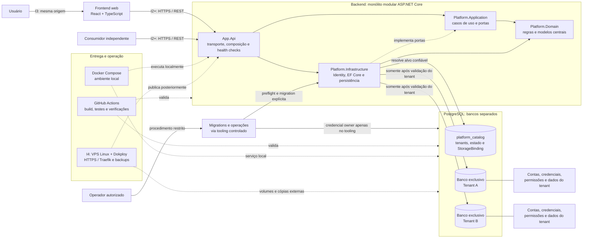
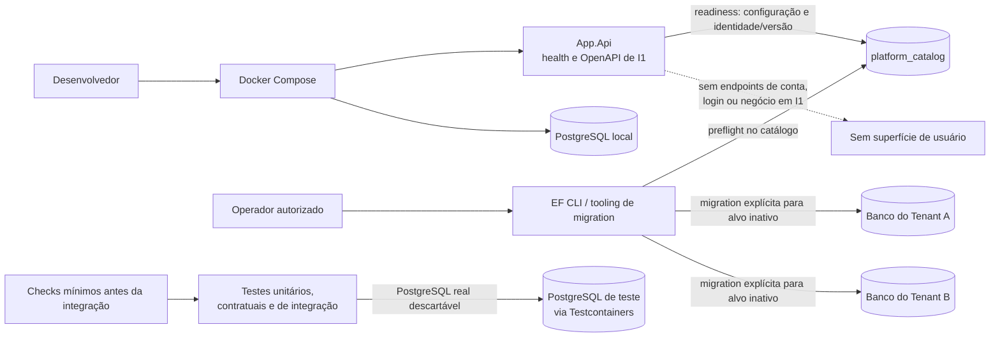

# Desenho da arquitetura sugerida

Este desenho consolida o plano da fundação e diferencia o primeiro incremento
(I1) da arquitetura evolutiva. Os componentes indicados como posteriores não fazem
parte da entrega inicial.

## Arquitetura evolutiva

### Regras importantes

- O catálogo central contém apenas metadados técnicos de tenants e referências
  seguras aos bancos; não armazena contas globais nem dados de negócio.
- A aplicação resolve o destino pelo catálogo confiável. Um identificador enviado
  pelo cliente não fornece credenciais nem autoriza, por si só, acesso ao tenant.
- Cada tenant tem banco próprio, incluindo suas contas, credenciais e permissões.
  A mesma pessoa ou email em dois tenants não compartilha identidade ou acesso.
- A API não aplica migrations no startup. O tooling executa migrations somente
  após validar o alvo, seu estado e a autorização operacional.
- A seta de frontend, login e operações de tenant representa incrementos posteriores;
  não indica endpoints de usuário disponíveis em I1.

## Recorte do primeiro incremento (I1)

I1 entrega backend executável, catálogo técnico mínimo, modelo e migrations de
usuários/acesso, execução local, testes com PostgreSQL e checks de backend. Não inclui
frontend, login HTTP, painel, endpoints de conta ou módulo de negócio. A API não cria
bancos nem altera esquemas durante o startup.

## Evolução prevista

| Incremento | Acréscimo principal |
|---|---|
| I1 — atual | Backend, persistência e migrations de usuários/acesso, Compose e validação de backend. |
| I2 — posterior | Login/logout e contexto por tenant, sessão revogável e procedimento restrito de contas/permissões. |
| I3 — posterior | Frontend web e validação da extensão modular. |
| I4 — antes de produção | Operação ampliada de tenants, publicação, backup e recuperação. |

**Referência:** [plano de implementação](./plan.md) e [especificação](./spec.md).
