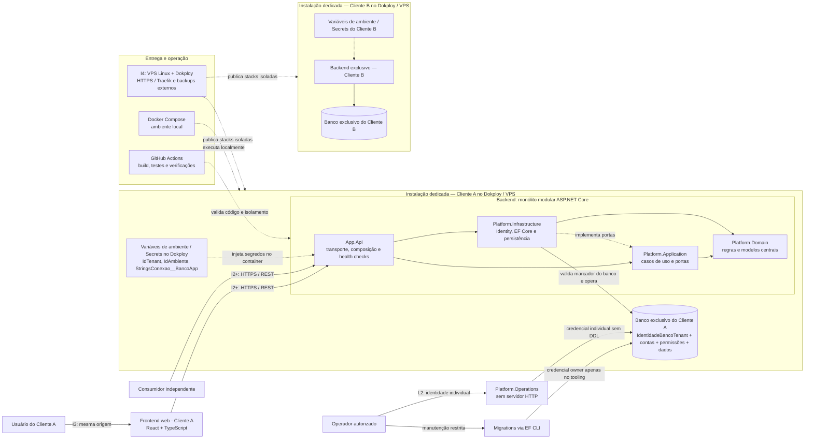
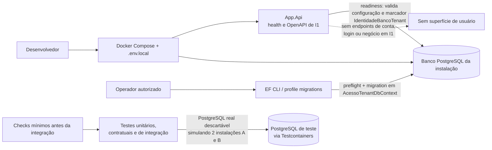
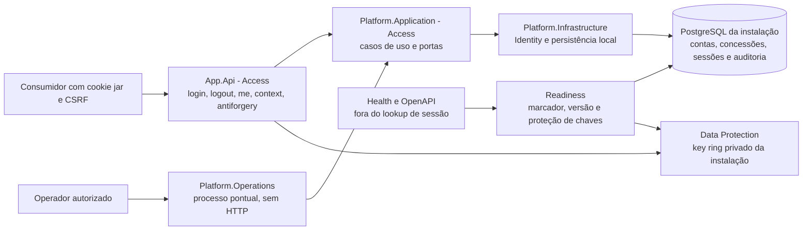
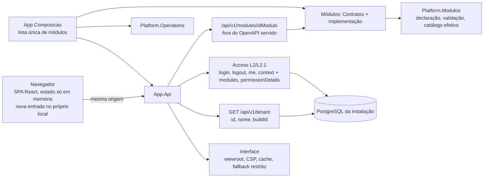

# Desenho da arquitetura sugerida

Este desenho consolida o plano da fundação no modelo **single-tenant por deploy
(1 instalação de backend + 1 banco PostgreSQL exclusivo da própria aplicação por cliente)**
e diferencia a L1/I1 entregue da L2/I2 planejada. Não existe banco apartado
de catálogo central (`platform_catalog`).

## Arquitetura evolutiva (implantação dedicada por cliente)



### Regras importantes

- **Sem banco de catálogo central (`platform_catalog`)**: só existe o banco da própria
  aplicação em cada instalação de cliente.
- **Segredos por cliente no Dokploy / VPS (ou cofre externo)**: cada cliente é uma
  aplicação/stack separada no Dokploy, onde suas variáveis de ambiente e segredos são
  configurados e injetados apenas nos containers daquele cliente.
- **Isolamento total de runtime e banco**: O backend do Cliente A não conhece a conexão
  nem o banco do Cliente B. Antes de operar, valida o marcador `IdentidadeBancoTenant`
  gravado no seu banco contra o `IdTenant` e `IdAmbiente` da sua configuração.
- **Contas locais ao banco da instalação**: cada cliente possui suas contas, credenciais,
  permissões e sessões no próprio banco. Email igual em dois clientes não compartilha conta.
- **Migrations fora do startup**: a API não aplica migrations no startup. O tooling executa
  migrations somente após validar a identidade do banco-alvo e a credencial owner.

## Recorte do primeiro incremento (I1)



I1 entrega backend executável, `AcessoTenantDbContext` com marcador da instalação e
modelo/migrations de usuários e permissões, execução local via Docker Compose, testes
com PostgreSQL real (validando duas bases independentes A e B) e checks de backend.
Não inclui banco de catálogo central, frontend, login HTTP, painel, endpoints de conta
ou módulo de negócio.

## L2/I2 — design sobre a base entregue

O [plano vigente](plan.md) adiciona cinco operações de acesso HTTP, store de sessão
no próprio banco, autorização atual e host operacional pontual. Nada abaixo é
implementado pelo comando de planejamento.



Runtime API, operador de acesso e owner de migrations têm credenciais distintas.
P0 bloqueia login se essa separação não estiver efetiva, inclusive na configuração
local. O host operacional não entra na imagem da API. O esquema nasce de uma
migration inicial única com o modelo completo.
Contas/permissões/sessões compartilham metadados auditáveis; operador tem identidade
individual, e o histórico operacional permanece imutável. Usuário mantém a herança
Identity e implementa o contrato comum; entidades próprias herdam `EntidadeAuditavel`.
Ver [ADR 0002](../../docs/adr/0002-sessoes-e-operacao-acesso-local.md).

## L2.1 — reabertura da L2: sessão por inatividade e teto absoluto

Priorizada antes da L3 ([plano](plan.md), research D31–D33). A sessão expira no que
ocorrer primeiro: inatividade (padrão 30 min, 5–240) ou teto absoluto contado do login
(padrão 600 min, 30–720), ambos fixados na emissão. A decisão continua no servidor e no
banco da instalação; o cookie e o ticket expiram no teto e não são reemitidos por uso.

```mermaid
sequenceDiagram
    participant C as Navegador / consumidor
    participant A as App.Api (pipeline G2)
    participant S as Store de sessão (Retrieve)
    participant F as FiltroRegistroUsoSessao
    participant D as PostgreSQL da instalação
    C->>A: requisição protegida + cookie
    A->>S: validar referência
    S->>D: ler sessão (UltimoUsoEm, janela, teto, revogação)
    alt agora ≥ min(UltimoUsoEm + janela, teto) ou revogada
        S-->>A: sem sessão → 401 (não renova)
    else válida
        A->>A: instalação ativa, CSRF, autorização (negação → não renova)
        A->>F: aceita
        opt agora − UltimoUsoEm ≥ 60 s
            F->>D: UltimoUsoEm = agora (Versao esperada; conflito descartado)
        end
        F->>A: handler
    end
```

Login cria a sessão com `UltimoUsoEm = CriadoEm`; logout e revogações seguem a L2 e
repetem quando o conflito vem só de um registro de uso. A migration inicial única é
regenerada (sem dados publicados). Ver ADR 0002 (revisão na L2.1).

## L3/I3 — design sobre a L2.1

O [plano vigente](plan.md) acrescenta a interface web servida pela própria API e a
composição de módulos em compilação, sobre o modelo de sessão da L2.1. A interface faz
nova entrada no próprio local quando a sessão expira (conteúdo escondido, estado da aba
preservado em memória, diálogo de credenciais) e mostra permissões com a descrição
declarada em código. Nada abaixo é implementado pelo planejamento.



A fundação nunca referencia módulos; módulos consomem outros módulos só por
`*.Contratos`. O catálogo de permissões (fundação + módulos) é o mesmo na API e no
operador. Módulos não têm dados na L3. Ver ADRs 0004/0005 (a redigir no gate Q0).

## Evolução prevista

| Incremento | Acréscimo principal |
|---|---|
| L1 / I1 — entregue | Backend, marcador da instalação, persistência e migrations de usuários/acesso, Compose e validação de backend. |
| L2 / I2 — entregue | Login/logout e contexto na instalação do cliente, sessão revogável e procedimento restrito de contas/permissões. |
| L2.1 — design atual, prioridade | Sessão por inatividade + teto absoluto, registro de uso limitado, migration inicial regenerada (SC-002 revisado). |
| L3 / I3 — design atual, após a L2.1 | Interface web de acesso servida pela API e extensão modular validada (SC-001, SC-004). |
| I4 — antes de produção | Publicação de instâncias por cliente no Dokploy/VPS, backup externo e recuperação. |

**Referência:** [plano de implementação](./plan.md) e [especificação](./spec.md).
