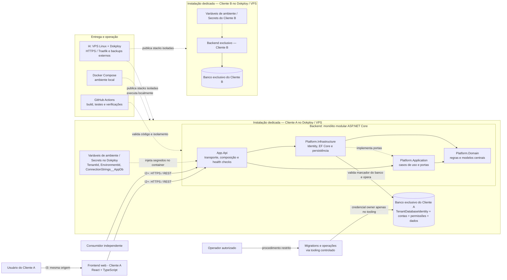

# Desenho da arquitetura sugerida

Este desenho consolida o plano da fundação no modelo **single-tenant por deploy
(1 instalação de backend + 1 banco PostgreSQL exclusivo da própria aplicação por cliente)**
e diferencia o primeiro incremento (I1) da arquitetura evolutiva. Não existe banco apartado
de catálogo central (`platform_catalog`).

## Arquitetura evolutiva (implantação dedicada por cliente)

### Regras importantes

- **Sem banco de catálogo central (`platform_catalog`)**: só existe o banco da própria
  aplicação em cada instalação de cliente.
- **Segredos por cliente no Dokploy / VPS (ou cofre externo)**: cada cliente é uma
  aplicação/stack separada no Dokploy, onde suas variáveis de ambiente e segredos são
  configurados e injetados apenas nos containers daquele cliente.
- **Isolamento total de runtime e banco**: o backend do Cliente A não conhece a conexão
  nem o banco do Cliente B. Antes de operar, valida o marcador `TenantDatabaseIdentity`
  gravado no seu banco contra o `TenantId` e `EnvironmentId` da sua configuração.
- **Contas locais ao banco da instalação**: cada cliente possui suas contas, credenciais,
  permissões e sessões no próprio banco. Email igual em dois clientes não compartilha conta.
- **Migrations fora do startup**: a API não aplica migrations no startup. O tooling executa
  migrations somente após validar a identidade do banco-alvo e a credencial owner.

## Recorte do primeiro incremento (I1)

I1 entrega backend executável, `TenantAccessDbContext` com marcador da instalação e
modelo/migrations de usuários e permissões, execução local via Docker Compose, testes
com PostgreSQL real (validando duas bases independentes A e B) e checks de backend.
Não inclui banco de catálogo central, frontend, login HTTP, painel, endpoints de conta
ou módulo de negócio.

## Evolução prevista

| Incremento | Acréscimo principal |
|---|---|
| I1 — atual | Backend, marcador da instalação, persistência e migrations de usuários/acesso, Compose e validação de backend. |
| I2 — posterior | Login/logout e contexto na instalação do cliente, sessão revogável e procedimento restrito de contas/permissões. |
| I3 — posterior | Frontend web e validação da extensão modular. |
| I4 — antes de produção | Publicação de instâncias por cliente no Dokploy/VPS, backup externo e recuperação. |

**Referência:** [plano de implementação](./plan.md) e [especificação](./spec.md).
